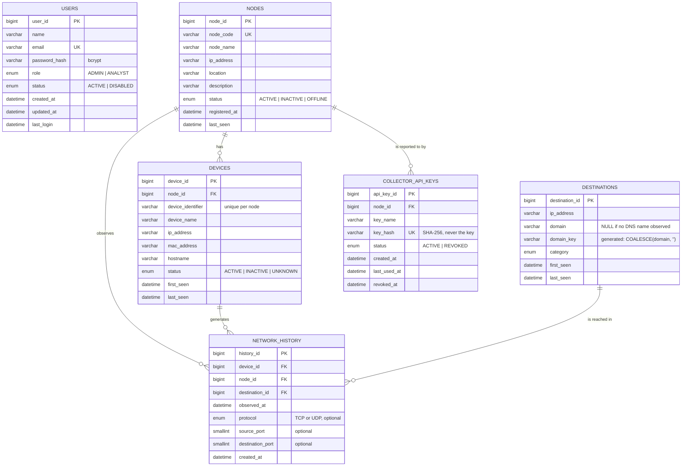

# Entity-relationship diagram

The database `network_monitor` has exactly six tables (`database/schema.sql`). The diagram below renders on
GitHub and in most Markdown viewers (Mermaid).

`users` is standalone: it is used for authentication and authorization only.

## Relationships

| Parent | Child | Cardinality | On delete |
|---|---|---|---|
| `nodes` | `devices` | 1 : N | `RESTRICT` |
| `nodes` | `collector_api_keys` | 1 : N | `RESTRICT` |
| `nodes` | `network_history` | 1 : N | `RESTRICT` |
| `devices` | `network_history` | 1 : N | `RESTRICT` |
| `destinations` | `network_history` | 1 : N | `RESTRICT` |

Every relationship that involves history uses `ON DELETE RESTRICT`, so history can never disappear through a
cascade. Nodes and users are deactivated (status), not deleted.

## Constraints that carry the design

- **Composite foreign key** `network_history (node_id, device_id) → devices (node_id, device_id)`. It is backed by
  `UNIQUE (node_id, device_id)` on `devices`. Together they make it impossible for MySQL to store an event whose
  device belongs to a different node than the event's node.
- **Device identity** is `UNIQUE (node_id, device_identifier)`, not the IP address, so a device that changes IP is
  still the same device.
- **Destination identity** is `UNIQUE (ip_address, domain_key)`. `domain` may be NULL, and MySQL treats NULLs as
  distinct in unique indexes, so the stored generated column `domain_key = COALESCE(domain, '')` gives NULL-domain
  destinations a reliable uniqueness rule. `domain_key` is never shown to users.
- **No `UNIQUE (device_id, destination_id)`** on `network_history`, on purpose: the same device must be able to reach
  the same destination again after the 30-second window. The 30-second rule is backend logic.

## Indexes (each supports a real query)

| Index | Used by |
|---|---|
| `network_history (device_id, observed_at)` | device history, the 30-second duplicate check |
| `network_history (node_id, observed_at)` | node activity and detail |
| `network_history (destination_id, observed_at)` | destination investigation |
| `network_history (observed_at)` | dashboard, reports and date filters |
| `nodes (status)`, `nodes (last_seen)` | node list filters and status |
| `devices (ip_address)`, `(status)`, `(last_seen)` | device search and list |
| `destinations (domain)`, `(category)`, `(last_seen)` | destination search and filters |
| `collector_api_keys (node_id, status)` | key management per node |

## Normalization

The design is approximately Third Normal Form. `network_history` stores only foreign keys, the event time and, when
a collector could observe them, the event's own `protocol`, `source_port` and `destination_port` (they describe this one
connection, so they depend only on `history_id`; they are `NULL` otherwise);
node names, locations, device IPs and hostnames, domains and categories live once in their own tables and are
resolved by joins. There are no repeating groups, and every non-key column depends on the key of its own table.
(`nodes.last_seen`, `devices.last_seen` and `destinations.last_seen` are deliberate denormalizations of
`MAX(observed_at)`, kept up to date in the same transaction that stores an event so lists do not need an
aggregate over the whole history.)

## Try it

`database/queries.sql` contains 20 read-only demonstration queries: joins, `LEFT JOIN`, `GROUP BY`, `HAVING`,
date ranges, destination and device investigation, plus audits that prove the integrity rules (no two stored
events within 30 seconds, and no device/node mismatches).
